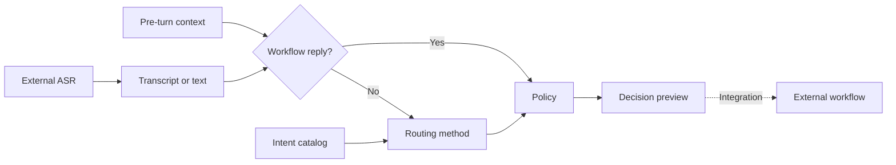
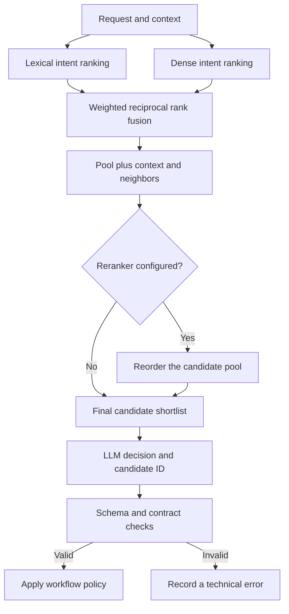
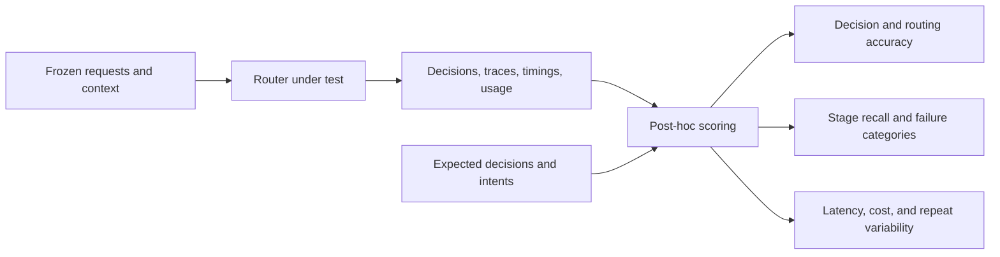

# IntentBench

IntentBench benchmarks the **decision models that turn a user's request into the right intent and workflow**. It is useful when building voice assistants: a speech recognizer supplies a transcript, and a separate decision layer decides what the user wants, whether clarification is needed, and which workflow should handle the request.

The workbench accepts **text and conversation context**. It does not ingest audio, run speech recognition, synthesize speech, or execute real business transactions. You can evaluate transcripts produced by your own speech pipeline, including recognition errors, without confusing speech-model quality with decision-model quality.

A local React interface and Python CLI share the same evaluation engine. Compare a lexical baseline, embedding retrieval, and retrieval followed by constrained model selection; optionally add reranking and calibrated semantic rejection. The application, guides, and bundled starter data are English. Imported data and user utterances retain their original language.

[Start locally](#start-locally) · [Architecture](#how-the-decision-pipeline-works) · [Strategy](#design-the-decision-before-choosing-a-model) · [Benchmark](#run-a-benchmark) · [Research](#research-behind-the-design)

**License:** the project's own code, documentation, and bundled synthetic examples are licensed under [Apache-2.0](LICENSE), unless a file states otherwise. Third-party libraries, model weights, datasets, and hosted services retain their own licenses and terms. Read the [security guidance](SECURITY.md) before connecting services or importing data; this is a trusted local-operator application without user authentication.

## How the decision pipeline works



Intent recognition is a **routing decision**, with conversation state as part of the input. Supported confirmations, cancellations, and demo workflow-field replies can bypass retrieval and model selection. Other requests use the chosen method. The final result can be `route`, `continue`, `cancel`, `clarify`, `out_of_scope`, or `handoff`; infrastructure and invalid model responses are recorded as `error`.

### Design the decision before choosing a model

Define each intent around an atomic business goal and destination workflow, with a stable ID, description, examples, exclusions, and rules distinguishing nearby intents. Keep “Claims” as a domain; separate reporting a claim from checking its status when they route differently. Split product or channel variants only when routing requires it.

Intent selection and collecting workflow fields are separate tasks:

| Request and context | Intended behavior |
|---|---|
| “Change my flight” without a booking reference | Route to ticket change; the workflow collects the reference and new date |
| “Where is my refund?” | Select refund status, rather than initiating a return |
| “Don't cancel my policy; change the address” | Select address change; respect negation and correction |
| “Close my card” when temporary blocking and permanent cancellation are available | Clarify which operation the user means |
| “Cancel” during an active workflow | Cancel that workflow; distinguish this from a new request to cancel a ticket |
| A request outside the catalog's domain, or an explicit request for a person | Use `out_of_scope` or `handoff`, respectively |

Supply pre-turn context for replies and topic switches. Missing fields do not make a clear goal ambiguous; multiple distinct goals require choosing which to start. The simulator handles a few banking fields; other workflows remain previews for integration. See [taxonomy and routing](docs/taxonomy-and-routing.md).

### Compare methods with different responsibilities

| Method | Candidate retrieval | Decision mechanism | Main tradeoff to measure |
|---|---|---|---|
| `lexical` | Character n-gram TF-IDF cosine blended with a BM25 component | Nearest candidate plus baseline/context rules; no LLM | Low inference cost, but terminology and near-neighbor ambiguity can limit quality |
| `e5` — semantic search | Configured embedding model and cosine similarity | Baseline/context rules, optionally with calibrated rejection; no LLM | Handles semantic similarity, but similarity alone does not establish the right operation |
| `hybrid_llm` | Lexical + dense fusion by default; semantic-only candidate profiles are also available | Constrained LLM selection after optional reranking | Adds interpretation of context and boundaries, along with latency, cost, and output-contract failures |

`e5` is the method identifier, not a requirement to use an E5-family model. **Hybrid retrieval** means combining lexical and dense rankings. **Retrieval followed by an LLM** means giving a decision model a shortlist; that shortlist may come from hybrid or semantic-only retrieval.

### Inside retrieval followed by model selection

The default hybrid path is:



Catalog descriptions and examples form the retrieval corpus. Lexical matching captures words and character patterns; embeddings complement it with semantic similarity. Catalog embeddings are prepared and cached for compatible catalog/model/representation versions, while each dense retrieval request needs a query embedding. Rankings are deduplicated by intent before fusion, so repeated examples do not become repeated votes. Reranking can reorder the pool, but cannot recover an absent intent.

The shortlist bounds catalog text sent to the selector: descriptions, evidence, exclusions, and selection rules, alongside bounded conversation context. Validation rejects invented candidate IDs and malformed decisions. An in-domain request whose candidate is absent should trigger clarification with `candidate_not_found`.

Shortlisting can reduce prompt size and make a growing catalog easier to inspect. It also creates a retrieval ceiling: missing candidates cannot be selected. Larger lists, embeddings, and rerankers add work; valid JSON can still express a wrong decision. Measure tradeoffs on identical held-out cases. Cosine and fusion scores are not confidence probabilities. Calibrated semantic rejection applies to `e5`, not an LLM-skipping gate for `hybrid_llm`. See [retrieval controls](docs/retrieval-quality.md) and [calibration](docs/calibration-and-language.md).

## Ready sector workspaces

Choose **Sector workspace** in the application. Each sector keeps its own catalog, cases, calibration, model registrations, and experiment history. Switching sectors retains custom additions and starts a fresh live conversation. Server-level `.env` defaults remain available across workspaces; registered model connections belong to the selected workspace.

| Sector | Workspace ID | Starter intents | Main operation families |
|---|---|---:|---|
| Banking | `demo` | 800 | Accounts, cards, transfers, loans, deposits, investments, digital banking, merchant services, bank-distributed insurance |
| Airline | `airline` | 200 | Booking and ticket servicing, payments and credits, check-in, seats, baggage and claims, disruptions, accessibility, family travel, airport/onboard services, loyalty, account and privacy |
| Insurance | `insurance` | 200 | General and specialist quotes, applications, coverage and renewals, policy servicing, billing, claims and appeals, beneficiaries, health/provider services, assistance, account support |
| E-commerce | `ecommerce` | 200 | Shopping and checkout, orders and delivery, returns and after-sales, digital goods, home services, gifts, recurring purchases, marketplace selling, business purchasing, rentals, safety and loyalty |

These synthetic catalogs cover common service lifecycles with explicit operation boundaries. They are starting points to review against your product scope, not a claim to include every business-specific operation. Banking also provides a larger distractor catalog for scaling experiments. Functional categories such as “Baggage” remain `domain` values inside a sector.

The expanded nonbank catalogs add 372 definitions in total: 130 airline, 126 insurance, and 116 e-commerce. Each has 400 catalog example utterances, 430 separate test cases (205 original plus 225 supplemental), and 80 separate calibration cases. Every nonhuman intent has at least two route examples, alongside negation, correction, synthetic noisy transcript, ambiguity, out-of-scope, handoff, and context challenges. Banking has 153 test cases and 72 calibration cases; its supplement covers all 47 routable core definitions and selected specific operations, not every generated banking intent. These are curated synthetic checks, not recorded ASR output or independent evidence of model accuracy.

Use **Intent catalog → Add intent** to append your own definition. Supply a stable ID, name, functional domain, description, examples, and workflow ID; add exclusions, confusable neighbors, a selection rule, channels, and workflow fields where needed. Existing intents are retained. **Export** downloads the full catalog; **Import JSON** replaces the active catalog with your complete JSON list. Keep labels and calibration data consistent with the replacement. Refit calibration after catalog changes.

Fresh sector workspaces receive their matching starter data atomically. Existing starter workspaces receive conservative, versioned migrations, including a separate case-depth supplement after historical catalog releases. Custom definitions, existing cases, intentional deletions, prior snapshots, and experiment results are retained; customized target/context definitions can exclude affected new cases. Trimmed or unrecognized catalogs are not expanded automatically. The English banking migration updates only recognized untouched bundled content. See [data provenance and handling](data/README.md) and [taxonomy guidance](docs/taxonomy-and-routing.md) for migration rules.

## Start locally

Use Python 3.12 and Node.js 22 or newer. Install dependencies and build the interface from the repository root:

```bash
python3 -m venv .venv
.venv/bin/pip install -r requirements.lock
npm --prefix apps/web ci
npm --prefix apps/web run build
```

### Offline lexical demo

```bash
INTENT_EMBEDDING_MODE=disabled INTENT_LLM_BASE_URL= PYTHONPATH=apps/api \
  .venv/bin/uvicorn app.main:app --host 127.0.0.1 --port 8002 --workers 1
```

The lexical baseline needs no API key or model download and makes no provider calls. This command explicitly disables the default model connections, overriding their `.env` settings. Registered model connections remain selectable; choose **Lexical baseline** for an offline evaluation. Dependency installation still requires network access.

### OpenRouter and other model connections

If `.env` does not exist, create it from the root `.env.example`. If it already exists, merge the required settings without overwriting your keys or other configuration. The template configures both default models for OpenRouter. Set:

```dotenv
INTENT_OPENROUTER_API_KEY=your_openrouter_api_key
```

Both the LLM and embedding defaults use this shared key unless a dedicated model key overrides it. Start the API without the offline overrides:

```bash
PYTHONPATH=apps/api .venv/bin/uvicorn app.main:app --host 127.0.0.1 --port 8002 --workers 1
```

Open [the application](http://127.0.0.1:8002) or [API documentation](http://127.0.0.1:8002/docs). In **Model connections**, inspect shared-key presence, choose your LLM and embedding connections, and explicitly test them. **Connection configured** only indicates that server settings are available; a passed test is separate current-session evidence. The panel also checks the selected embedding's persistent index and calibration without making model calls or building an index. See the [model connection guide](docs/model-registry.md) for next actions and private endpoints.

Restart the API after changing the shared OpenRouter key or other startup-loaded settings. Custom file-based registration keys have a separate refresh workflow documented in the guide. For frontend development, run `npm --prefix apps/web run dev` in another terminal; its proxy targets port 8002. On Windows, replace `.venv/bin` with `.venv/Scripts` and use your shell's environment-variable syntax. Persistent vector index locking requires WSL or Docker.

### Docker

```bash
docker compose up --build
```

Docker serves the interface/API on local port 8002 and persists data in `studio-data`. After changing values supplied through `.env` / Compose `env_file`, recreate the container so it receives the updated environment:

```bash
docker compose up -d --force-recreate studio
```

An ordinary container restart retains its existing environment. The base image contains no PyTorch or model weights. Use one API worker: jobs and coordination are managed in-process.

## Run a benchmark

```bash
INTENT_EMBEDDING_MODE=disabled INTENT_LLM_BASE_URL= \
  .venv/bin/python scripts/evaluate.py --workspace airline --source seed --methods lexical --limit 430
```

Use `demo`, `insurance`, or `ecommerce` for another sector. Results are written under ignored `artifacts/runs/`. **Experiments** uses the same engine and compares method/model, retrieval-strategy, and catalog-size combinations on a frozen set of cases.

For a ready conversation sample benchmark, use the [synthetic-v1 sample pack](data/samples/synthetic-v1/README.md): 192 newly authored English turns, 48 per sector, with explicit pre-turn context, expected labels, and rationales. It runs in temporary storage separately from the existing seed tests and private workspaces:

```bash
INTENT_EMBEDDING_MODE=disabled INTENT_LLM_BASE_URL= \
  .venv/bin/python scripts/evaluate.py --sample-pack synthetic-v1 --workspace airline \
  --methods lexical --limit 48 --repetitions 2 --max-provider-requests 0
```

Choose `demo`, `insurance`, or `ecommerce` for the other samples. Do not add `--source` to a sample-pack command. The guide includes all sector commands, provenance, coverage, input-only CSV exports, and a bounded remote example. These public synthetic annotations support development and regression checks, not production-accuracy claims.

Add `--repetitions 2` to repeat that frozen cohort. Optional `--max-provider-requests`, `--max-duration-seconds`, and `--max-reported-cost-usd` controls apply across preparation, variants, and repeats. The USD threshold is a soft stop based on supported OpenRouter reported usage, not a guaranteed billing cap. Ctrl+C requests cooperative cancellation and saves partial JSON after in-flight work finishes. Evaluation exits are completed `0`, stopped `2`, failed `1`, and cancelled `130`. See [controlled and repeated experiments](docs/benchmark-experiments.md) for bounds, accounting, and statistical interpretation.

The CLI defaults to 100 cases; use `--limit 430` for the complete airline, insurance, or e-commerce cohort and `--limit 153` for banking, or set **Maximum cases** accordingly in **Experiments**. The nonbank cohort requires all 200 catalog intents. The full banking cohort requires 59 intents, or 67 with calibration; `100, 200, 800` supports both. For smaller catalog-size comparisons, select a smaller fixed cohort first and keep it unchanged across sizes; do not remove cases separately for each size. Preserved user edits and deletions can make an existing workspace's actual counts differ from the starter totals.

For reproducible comparisons:

1. Define atomic business goals and stable labels. Write positive examples, exclusions, and near-neighbor rules. Make product variants separate intents only when they represent a distinct routing decision; leave ordinary workflow parameters as fields.
2. Separate development, calibration, and final test data. Keep conversations and near-duplicates together. Include clear requests, ambiguous and multiple goals, out-of-scope requests, context switches, and handoffs. For voice use cases, include independently reviewed transcripts with omissions, repetitions, corrections, names, numbers, and recognition noise.
3. Freeze the catalog, labels, selected cases, and splits. Never tune prompts, examples, or thresholds on the final test set. Fit semantic rejection on the separate calibration split.
4. Record model/provider identifiers, prompt/protocol version, retrieval settings, fingerprints, hardware, and concurrency. Hold other settings fixed when changing a model. Provider aliases and hosted models can change.
5. Report routing and overall decision accuracy, macro-F1, candidate Recall@K, OOS false acceptance, in-scope false rejection, clarification, coverage, and technical errors with their denominators. A correct candidate list does not guarantee a correct final decision.
6. Report preparation separately from query p50/p95 latency, and include sample counts and token usage. These timings exclude your speech recognition and speech synthesis pipeline.

### Locate the failure before changing the model



Per-case gold decisions and intent labels are not router inputs or retrieval queries. Cohort validation can use expected IDs to check catalog-subset coverage. Routing accuracy covers expected-`route` cases; overall decision accuracy also includes clarification, continuation, cancellation, handoff, and rejection. Technical errors remain failures in both denominators.

| Observation | Inspect before changing the decision model |
|---|---|
| Expected intent missing from source rankings | Catalog coverage, examples, embedding/query formatting |
| Present in a source but absent from the pool or final shortlist | Fusion budgets, neighbor additions, reranker/candidate cutoffs |
| Present in the final shortlist but decision is wrong | Selector behavior, intent boundaries, context, and workflow policy |
| Provider or schema failure | Error stage and safe diagnostics; keep it separate from a semantic miss |

Stage recall uses eligible expected-route cases whose retrieval completed; context bypasses and incomplete retrieval are reported separately. Candidate-conditioned accuracy asks how often the final decision is correct when the expected intent is available. Compare OOS false acceptance, false rejection, coverage, and clarification together: rejecting everything is not a useful router. Repeated runs expose variability; preserve interrupted attempts and their costs when reporting completed-run statistics.

The bundled cases support development and regression checks. They are not an independent held-out benchmark or evidence of production accuracy. Historical measurements in the guides used earlier Turkish banking catalogs and prompt versions; rerun comparisons on a fixed current dataset instead of treating translation as an accuracy improvement.

[Synthetic conversation samples](data/samples/synthetic-v1/README.md) · [Experiment controls and transcript review](docs/benchmark-experiments.md) · [Model comparison](docs/model-comparison.md) · [Catalog sizes](docs/catalog-scaling.md) · [Calibration](docs/calibration-and-language.md) · [Retrieval and reranking](docs/retrieval-quality.md)

## Research behind the design

These papers explain relevant ideas; their results are not accuracy or latency claims for IntentBench:

- **Sentence-BERT — Reimers and Gurevych (2019):** introduces sentence embeddings suitable for semantic similarity with cosine comparison. It provides background for embedding retrieval, without implying that every configured model uses SBERT or performs equally on intent catalogs. [Paper](https://aclanthology.org/D19-1410/)
- **Reciprocal Rank Fusion — Cormack, Clarke, and Buettcher (2009):** combines ranked retrieval lists using reciprocal ranks. Its TREC/LETOR experiments motivate rank aggregation; gains in those settings do not guarantee gains for this project's lexical/dense intent fusion. [Paper](https://plg.uwaterloo.ca/~gvcormac/cormacksigir09-rrf.pdf)
- **Retrieval-Augmented Generation — Lewis et al. (2020):** combines neural retrieval and generation for knowledge-intensive language tasks. It offers a conceptual connection to conditioning a model on retrieved evidence. IntentBench selects intents; it does not implement the paper's trained RAG architecture or question-answering system. [Paper](https://proceedings.neurips.cc/paper/2020/hash/6b493230205f780e1bc26945df7481e5-Abstract.html)
- **An Evaluation Dataset for Intent Classification and Out-of-Scope Prediction — Larson et al. (2019):** evaluates 150 intents across ten domains and highlights the difficulty of OOS detection despite strong in-scope classification. This motivates separate rejection metrics; CLINC150 is not the bundled dataset. [Paper](https://aclanthology.org/D19-1131/)
- **Lost in the Middle — Liu et al. (2024):** finds sensitivity to information position in long contexts on question-answering and key-value retrieval tasks. This motivates testing shortlist size and presentation; it does not establish an optimal candidate count for intent routing. [Paper](https://aclanthology.org/2024.tacl-1.9/)

## Use your own data

Keep private files under `data/private/` or outside the repository. In the selected workspace, use **Cases → Import benchmark CSV**, or run:

```bash
.venv/bin/python scripts/import_benchmark.py data/private/benchmark.csv --workspace airline
```

The importer accepts UTF-8/BOM, comma/semicolon/tab separators, and multiline fields. `Question` supplies the input. Optional `BenchmarkSessionId` and `BenchmarkSessionMessageId` identify source records. `Answer` is review context and is not sent to the model; `Message Flow` supplies limited source metadata. Source `TRUE/FALSE` flags are retained without assuming they are correct intent labels. Review labels and assign splits before evaluating imported cases. The API's source name `customer` describes an import category, not verified provenance.

Optional `SourceDatasetId`, `Context`, and `Split` columns add stable identities across files, bounded explicit pre-turn context, and conversation-safe splits. The API and CLI validate and import atomically, report actual inserted/already-present counts, and preserve human review on identical replay. Move a conversation's split with the whole-conversation action. The [synthetic banking CSV template](data/demo/transcript-example.csv), also downloadable in **Cases**, is a format example only; no real transcript dataset is bundled. Read the [schema and review workflow](docs/benchmark-experiments.md#import-transcripts-without-changing-their-meaning) before preparing private exports.

Database files, raw imports, credentials, vector indexes, and case-level outputs remain local. Git ignore rules do not anonymize data or protect copies elsewhere. Imported transcripts are not automatically translated, and an English interface does not validate multilingual routing.

## Connect models deliberately

Create `.env` from `.env.example` when configuring models, or merge settings into your existing file; protect it with `chmod 600 .env` on macOS/Linux. Never commit keys. The [model connection guide](docs/model-registry.md) covers OpenRouter, TypeSafe Jev, local embeddings, OpenAI-compatible endpoints, and rerankers.

Remote methods send input text and relevant catalog/context to the provider. Index preparation can send the entire selected catalog; reranking sends the query and candidate texts. Review the actual contents, destination, provider policy, and cost before connection tests, indexing, calibration, or evaluation. A workspace named `demo` can contain user data.

```bash
.venv/bin/python scripts/check_models.py --workspace demo
.venv/bin/python scripts/warm_models.py --workspace demo --embedding-id default
.venv/bin/python scripts/reindex.py --workspace demo --embedding-id default
```

Connection checks send synthetic probes and may incur charges. Warm/reindex commands prepare the catalog index and can incur embedding charges. They require an existing workspace/catalog. Connectivity does not establish accuracy. Indexes reside under `INTENT_DATA_DIR/vector-indexes/`; catalog, model, or representation changes require compatible indexes and calibration.

[Embedding options](docs/embedding-selection.md) · [TypeSafe Jev](docs/typesafe-jev.md) · [Live views](docs/live-demo-views.md)

## Development

```bash
.venv/bin/pytest -q
npm --prefix apps/web test
npm --prefix apps/web run build
```

Run backend tests and the production build sequentially because both can access the frontend asset directory. Tests cover routing contracts, provider boundaries, data separation, metrics, workspace isolation, migrations, and interface behavior. Simulated HTTP responses do not establish live model quality.

| Path | Purpose |
|---|---|
| `apps/api/app` | API, storage, retrieval, decisions, calibration, evaluation |
| `apps/web` | English React/TypeScript interface |
| `data/demo` | Banking catalog, test/calibration cases, migration records |
| `data/presets` | Sector manifest and airline, insurance, e-commerce starter data |
| `data/samples/synthetic-v1` | Versioned four-sector conversation samples, annotations, and derived import CSVs |
| `data/private` | Ignored local data and credentials |
| `scripts` | Import, evaluation, model checks, indexing |
| `tests` | Behavior and integration tests |
| `docs` | Technical protocols, historical observations, release preparation |

Read the [contribution guidelines](CONTRIBUTING.md). Include the [license](LICENSE) when redistributing the project and retain applicable third-party notices.
