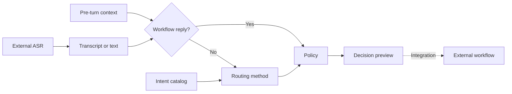
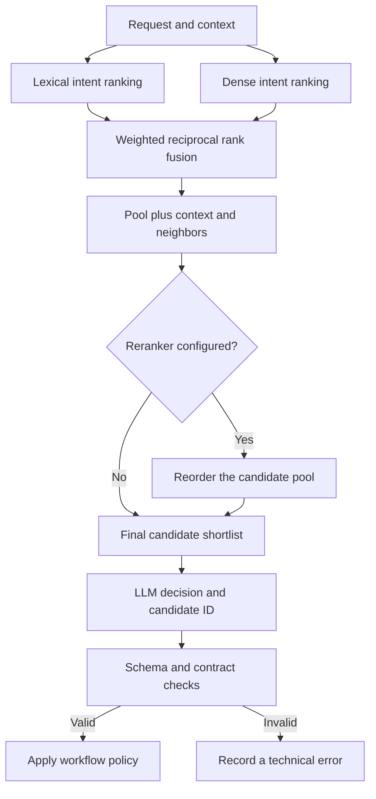

# Decision pipeline architecture

[Documentation index](README.md) · [Routing strategy](taxonomy-and-routing.md) · [Benchmarking](benchmarking.md)

IntentBench accepts text and pre-turn conversation context. For voice assistants, an external speech recognizer supplies the transcript. The workbench does not ingest audio, synthesize speech, or execute business transactions. It evaluates the decision layer independently of speech-model quality.

Intent recognition is a **routing decision**, with conversation state as part of the input. Supported confirmations, cancellations, and demo workflow-field replies can bypass retrieval and model selection. Other requests use the chosen method. The final result can be `route`, `continue`, `cancel`, `clarify`, `out_of_scope`, or `handoff`; infrastructure and invalid model responses are recorded as `error`.

See [taxonomy and routing strategy](taxonomy-and-routing.md) for intent boundaries and workflow ownership.

## Compare methods with different responsibilities

| Method | Candidate retrieval | Decision mechanism | Main tradeoff to measure |
|---|---|---|---|
| `lexical` | Character n-gram TF-IDF cosine blended with a BM25 component | Nearest candidate plus baseline/context rules; no LLM | Low inference cost, but terminology and near-neighbor ambiguity can limit quality |
| `e5` — semantic search | Configured embedding model and cosine similarity | Baseline/context rules, optionally with calibrated rejection; no LLM | Handles semantic similarity, but similarity alone does not establish the right operation |
| `hybrid_llm` | Lexical + dense fusion by default; semantic-only candidate profiles are also available | Constrained LLM selection after optional reranking | Adds interpretation of context and boundaries, along with latency, cost, and output-contract failures |

`e5` is the method identifier, not a requirement to use an E5-family model. **Hybrid retrieval** means combining lexical and dense rankings. **Retrieval followed by an LLM** means giving a decision model a shortlist; that shortlist may come from hybrid or semantic-only retrieval.

## Inside retrieval followed by model selection

The default hybrid path is:

Catalog descriptions and examples form the retrieval corpus. Lexical matching captures words and character patterns; embeddings complement it with semantic similarity. Catalog embeddings are prepared and cached for compatible catalog/model/representation versions, while each dense retrieval request needs a query embedding. Rankings are deduplicated by intent before fusion, so repeated examples do not become repeated votes. Reranking can reorder the pool, but cannot recover an absent intent.

The shortlist bounds catalog text sent to the selector: descriptions, evidence, exclusions, and selection rules, alongside bounded conversation context. Validation rejects invented candidate IDs and malformed decisions. An in-domain request whose candidate is absent should trigger clarification with `candidate_not_found`.

Shortlisting can reduce prompt size and make a growing catalog easier to inspect. It also creates a retrieval ceiling: missing candidates cannot be selected. Larger lists, embeddings, and rerankers add work; valid JSON can still express a wrong decision. Measure tradeoffs on identical held-out cases. Cosine and fusion scores are not confidence probabilities. Calibrated semantic rejection applies to `e5`, not an LLM-skipping gate for `hybrid_llm`. See [retrieval controls](retrieval-quality.md) and [calibration](calibration-and-language.md).
