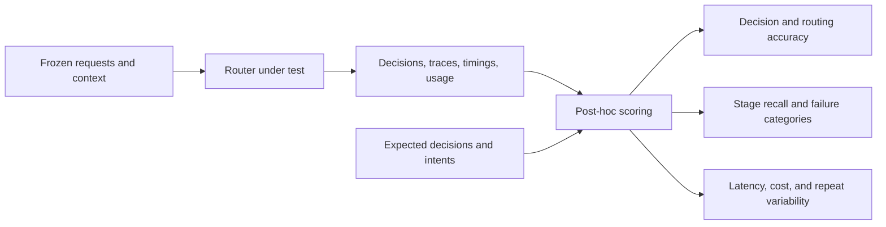

# Benchmarking and interpreting results

[Documentation index](README.md) · [Experiment controls and imports](benchmark-experiments.md) · [Routing strategy](taxonomy-and-routing.md)

After [local setup](getting-started.md), run the lexical baseline from the repository root:

```bash
INTENT_EMBEDDING_MODE=disabled INTENT_LLM_BASE_URL= \
  .venv/bin/python scripts/evaluate.py --workspace airline --source seed --methods lexical --limit 430
```

Use `demo`, `insurance`, or `ecommerce` for another sector. Results are written under ignored `artifacts/runs/`. **Experiments** uses the same engine and compares method/model, retrieval-strategy, and catalog-size combinations on a frozen set of cases.

For a ready conversation sample benchmark, use the [synthetic-v1 sample pack](../data/samples/synthetic-v1/README.md): 192 newly authored English turns, 48 per sector, with explicit pre-turn context, expected labels, and rationales. It runs in temporary storage separately from the existing seed tests and private workspaces:

```bash
INTENT_EMBEDDING_MODE=disabled INTENT_LLM_BASE_URL= \
  .venv/bin/python scripts/evaluate.py --sample-pack synthetic-v1 --workspace airline \
  --methods lexical --limit 48 --repetitions 2 --max-provider-requests 0
```

Choose `demo`, `insurance`, or `ecommerce` for the other samples. Do not add `--source` to a sample-pack command. The guide includes all sector commands, provenance, coverage, input-only CSV exports, and a bounded remote example. These public synthetic annotations support development and regression checks, not production-accuracy claims.

Add `--repetitions 2` to repeat that frozen cohort. Optional `--max-provider-requests`, `--max-duration-seconds`, and `--max-reported-cost-usd` controls apply across preparation, variants, and repeats. The USD threshold is a soft stop based on supported OpenRouter reported usage, not a guaranteed billing cap. Ctrl+C requests cooperative cancellation and saves partial JSON after in-flight work finishes. Evaluation exits are completed `0`, stopped `2`, failed `1`, and cancelled `130`. See [controlled and repeated experiments](benchmark-experiments.md) for bounds, accounting, and statistical interpretation.

The CLI defaults to 100 cases; use `--limit 430` for the complete airline, insurance, or e-commerce cohort and `--limit 153` for banking, or set **Maximum cases** accordingly in **Experiments**. The nonbank cohort requires all 200 catalog intents. The full banking cohort requires 59 intents, or 67 with calibration; `100, 200, 800` supports both. For smaller catalog-size comparisons, select a smaller fixed cohort first and keep it unchanged across sizes; do not remove cases separately for each size. Preserved user edits and deletions can make an existing workspace's actual counts differ from the starter totals.

## Design a reproducible comparison

1. Define atomic business goals and stable labels. Write positive examples, exclusions, and near-neighbor rules. Make product variants separate intents only when they represent a distinct routing decision; leave ordinary workflow parameters as fields.
2. Separate development, calibration, and final test data. Keep conversations and near-duplicates together. Include clear requests, ambiguous and multiple goals, out-of-scope requests, context switches, and handoffs. For voice use cases, include independently reviewed transcripts with omissions, repetitions, corrections, names, numbers, and recognition noise.
3. Freeze the catalog, labels, selected cases, and splits. Never tune prompts, examples, or thresholds on the final test set. Fit semantic rejection on the separate calibration split.
4. Record model/provider identifiers, prompt/protocol version, retrieval settings, fingerprints, hardware, and concurrency. Hold other settings fixed when changing a model. Provider aliases and hosted models can change.
5. Report routing and overall decision accuracy, macro-F1, candidate Recall@K, OOS false acceptance, in-scope false rejection, clarification, coverage, and technical errors with their denominators. A correct candidate list does not guarantee a correct final decision.
6. Report preparation separately from query p50/p95 latency, and include sample counts and token usage. These timings exclude your speech recognition and speech synthesis pipeline.

## Locate the failure before changing the model



Per-case gold decisions and intent labels are not router inputs or retrieval queries. Cohort validation can use expected IDs to check catalog-subset coverage. Routing accuracy covers expected-`route` cases; overall decision accuracy also includes clarification, continuation, cancellation, handoff, and rejection. Technical errors remain failures in both denominators.

| Observation | Inspect before changing the decision model |
|---|---|
| Expected intent missing from source rankings | Catalog coverage, examples, embedding/query formatting |
| Present in a source but absent from the pool or final shortlist | Fusion budgets, neighbor additions, reranker/candidate cutoffs |
| Present in the final shortlist but decision is wrong | Selector behavior, intent boundaries, context, and workflow policy |
| Provider or schema failure | Error stage and safe diagnostics; keep it separate from a semantic miss |

Stage recall uses eligible expected-route cases whose retrieval completed; context bypasses and incomplete retrieval are reported separately. Candidate-conditioned accuracy asks how often the final decision is correct when the expected intent is available. Compare OOS false acceptance, false rejection, coverage, and clarification together: rejecting everything is not a useful router. Repeated runs expose variability; preserve interrupted attempts and their costs when reporting completed-run statistics.

The bundled cases support development and regression checks. They are not an independent held-out benchmark or evidence of production accuracy. Historical measurements in the guides used earlier Turkish banking catalogs and prompt versions; rerun comparisons on a fixed current dataset instead of treating translation as an accuracy improvement.

[Synthetic conversation samples](../data/samples/synthetic-v1/README.md) · [Experiment controls and transcript review](benchmark-experiments.md) · [Model comparison](model-comparison.md) · [Catalog sizes](catalog-scaling.md) · [Calibration](calibration-and-language.md) · [Retrieval and reranking](retrieval-quality.md)
